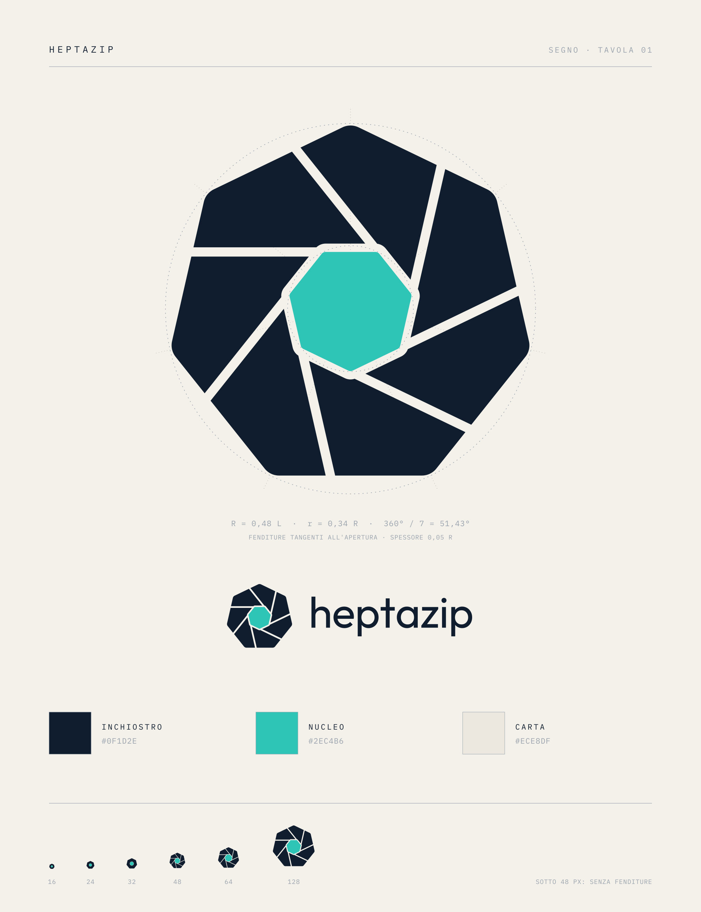

# Logo di Heptazip

Il segno è un ettagono (hepta = sette) diviso in sette lame che convergono verso un
nucleo, come un diaframma: i dati raccolti in un centro denso, sette flussi che lavorano
insieme. La geometria è calcolata, non disegnata: raggio interno 0,34 R, sette fenditure
tangenti all'apertura, spessore 0,05 R. Sotto i 48 px il segno perde le fenditure.
La filosofia visiva è in [filosofia-visiva.md](filosofia-visiva.md).

| File | Uso |
|---|---|
| `heptazip-logo.svg`, `.png` | logo con il nome, sfondo chiaro |
| `heptazip-logo-dark.svg`, `.png` | logo con il nome, sfondo scuro |
| `heptazip-mark.svg`, `heptazip-mark-dark.svg` | solo il segno |
| `heptazip-mark-{16..512}.png` | icone |
| `heptazip.ico` | icona Windows (16-256 px) |
| `heptazip-about.ico` | logo della finestra Informazioni (202×63, misura reale) |
| `heptazip-menu.bmp` | segno a 1 bit 13×13 per il menu contestuale di Explorer |

Colori: inchiostro `#0F1D2E`, nucleo `#2EC4B6`, carta `#ECE8DF`.

## Rigenerare

Tutti i file sono prodotti da [`tools/logo/make_logo.py`](../../tools/logo/make_logo.py)
(richiede shapely, fonttools, cairosvg, Pillow):

    python3 tools/logo/make_logo.py Outfit-Regular.ttf docs/logo IBMPlexMono-Regular.ttf

Nella GUI Windows i file sono copiati con i nomi originali di 7-Zip (le risorse `.rc`
non cambiano):

| File | Risorsa |
|---|---|
| `heptazip.ico` | `CPP/7zip/UI/FileManager/FM.ico`, `CPP/7zip/UI/GUI/FM.ico` |
| `heptazip-about.ico` | `CPP/7zip/UI/FileManager/7zipLogo.ico` |
| `heptazip-menu.bmp` | `CPP/7zip/UI/Explorer/MenuLogo.bmp` |

## Caratteri

Il testo è convertito in tracciati: i file non richiedono i caratteri installati.

- Nome: [Outfit](https://github.com/Outfitio/Outfit-Fonts), SIL Open Font License 1.1
  ([Outfit-OFL.txt](Outfit-OFL.txt)).
- Etichette della tavola: [IBM Plex Mono](https://github.com/IBM/plex), SIL Open Font
  License 1.1 ([IBMPlexMono-OFL.txt](IBMPlexMono-OFL.txt)).
